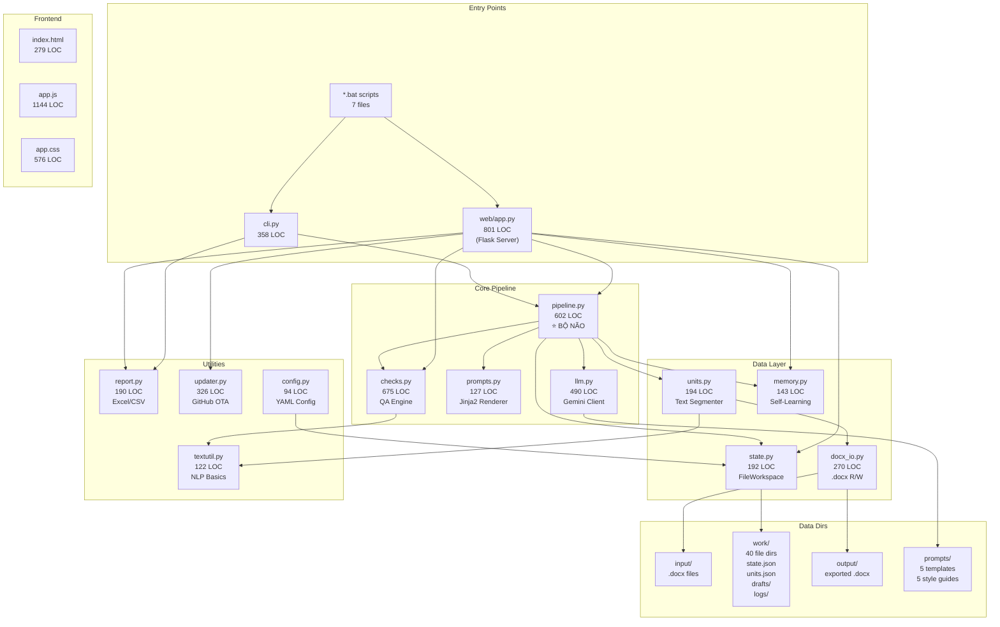
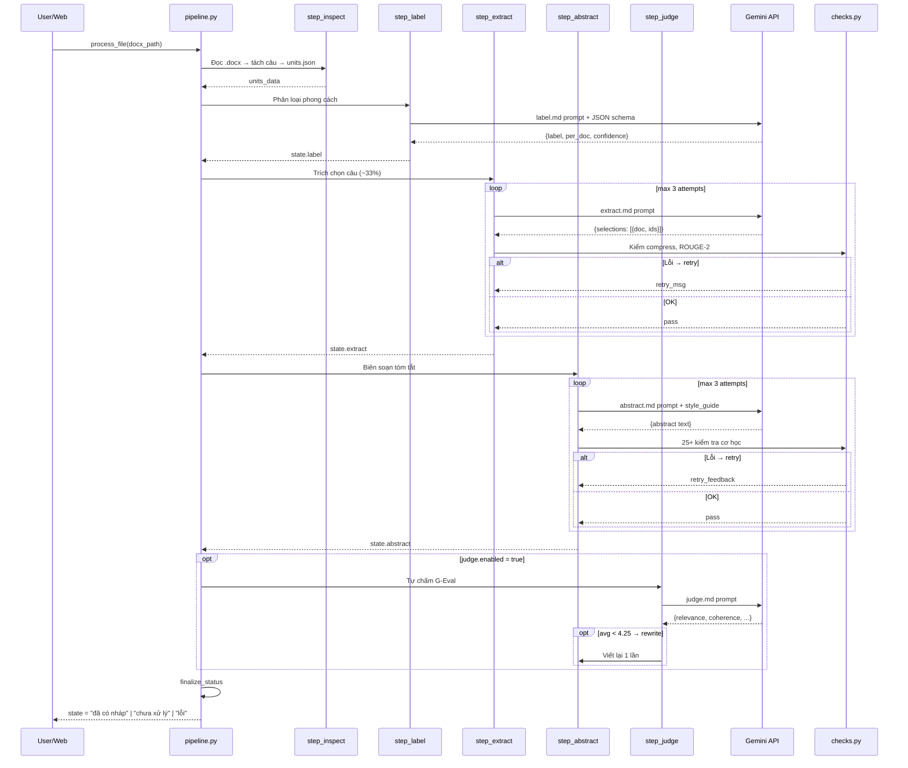
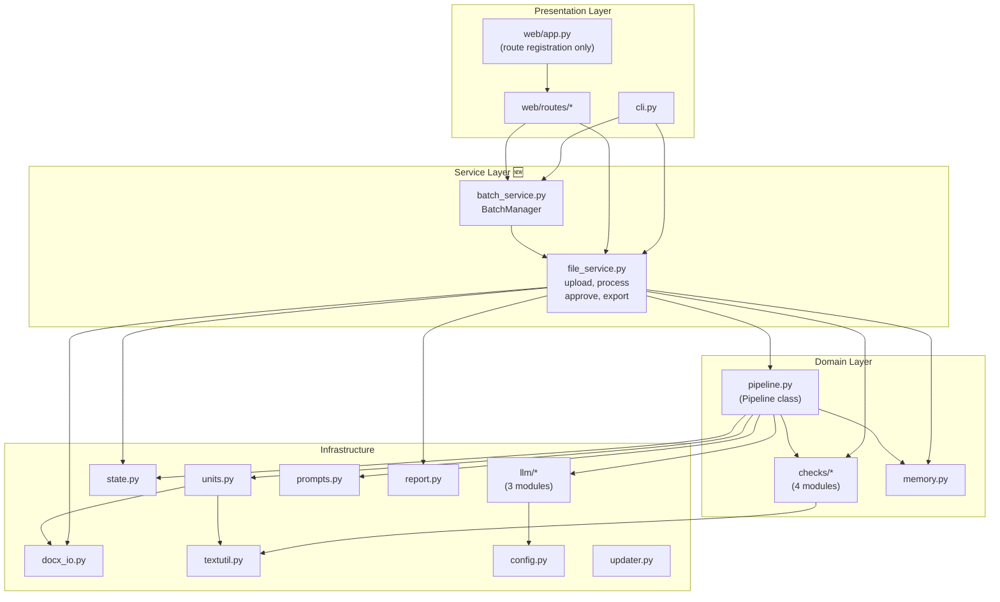

# 🏗️ Phân tích Kiến trúc Dự án TomTatBienSoan

> [!NOTE]
> Phân tích toàn diện dựa trên việc đọc **100% source code** (15 module Python, ~3,200 dòng logic + 1,144 dòng JS + 576 dòng CSS + 279 dòng HTML) và cấu trúc 20,493 file, ~387 MB.

---

## 1. Tổng quan Dự án

**Mục đích:** Công cụ tự động hóa quy trình "Tóm tắt – Biên soạn" văn bản tiếng Việt dùng Gemini API, chạy local trên Windows, hỗ trợ cả CLI batch và Web UI review.

**Tech Stack:**
- Python 3.12, google-genai SDK (Interactions API)
- Flask web server (127.0.0.1:8765)
- Vanilla JS (SPA pattern), CSS thuần
- python-docx cho I/O .docx, openpyxl cho báo cáo Excel
- Pool 60+ API keys xoay vòng (Free Tier Gemini)

---

## 2. Kiến trúc Hiện tại — Bản đồ Module



---

## 3. Pipeline Xử lý — Luồng AI 5 bước



---

## 4. Đánh giá Kiến trúc Hiện tại

### ✅ Điểm Mạnh
| # | Điểm | Chi tiết |
|---|-------|----------|
| 1 | **Pipeline rõ ràng** | 5 bước tuần tự, mỗi bước independent, có retry + best-candidate selection |
| 2 | **API Key Pool thông minh** | 60+ key xoay vòng, RPM tracking, cooldown, quota exhaustion per-model, persistent trên `quota_exhausted.json` |
| 3 | **Bộ kiểm tra cơ học mạnh** | 25+ rule checks (ROUGE-2, BARTScore, G-Eval ước lượng, dấu thập phân, bullet, markdown, số liệu bịa...) |
| 4 | **Self-learning Memory** | Tự học từ bài đã duyệt → Few-shot prompt cho bài sau |
| 5 | **Version history** | Mỗi lần chạy AI/sửa thủ công đều lưu drafts/vNNN.json, có restore |
| 6 | **Separation of concerns** | Config tách YAML, prompt tách Jinja2, state tách JSON → dễ tune |
| 7 | **Mock client** | Test toàn bộ pipeline mà không tốn API |
| 8 | **OTA Update** | Tự cập nhật code/prompt từ GitHub (git pull hoặc ZIP archive) |
| 9 | **Fallback model chain** | 5 cấp model tự trượt khi hết quota: hydrogen → 3.8 flash → 3.6 flash → 3.5 flash-lite → 3.1 flash-lite |
| 10 | **Phát hiện file bất thường** | 8 loại file "nghi hủy" (chuyển khoản, danh bạ, từ điển, lặp từ...) |

### ⚠️ Vấn đề & Rủi ro

| # | Vấn đề | Mức độ | File | Giải thích |
|---|--------|--------|------|------------|
| 1 | **web/app.py là God Object** | 🔴 Cao | `web/app.py` (801 LOC) | Chứa 20+ route handlers, `BatchManager`, client caching, file resolution, tất cả trong 1 closure `create_app()` |
| 2 | **checks.py quá tải** | 🟡 TB | `checks.py` (675 LOC) | Vừa kiểm tra extract, vừa kiểm tra abstract, vừa ước lượng ROUGE-2/BARTScore/G-Eval, vừa phát hiện file bất thường — 4 trách nhiệm khác nhau |
| 3 | **Duplicate `return reasons`** | 🔴 Cao | `checks.py:177` | Hàm `check_suspicious_document` có **2 lần** `return reasons` (line 175 và 177) — dòng 177 là dead code nhưng gây confusion |
| 4 | **Frontend monolith** | 🟡 TB | `app.js` (1,144 LOC) | Toàn bộ SPA logic (fetch, render, event handlers) trong 1 file JS thuần, không component |
| 5 | **Global mutable state** | 🟡 TB | `textutil.py` | `_abbrevs`, `_heading_words` là global mutable, `configure()` thay đổi chúng — unsafe khi multi-thread |
| 6 | **Thiếu type hints systematic** | 🟢 Thấp | Nhiều file | Dùng `dict` thay vì dataclass cho state, config — dễ sai key |
| 7 | **1 file test duy nhất** | 🟡 TB | `test_tomtat.py` (28K) | Test monolith, không phân tách theo module |
| 8 | **No async I/O** | 🟢 Thấp | `llm.py`, `web/app.py` | Dùng threading cho concurrency thay vì asyncio — OK cho scale hiện tại nhưng chạm trần ở ~12 threads |
| 9 | **Config là `dict` subclass** | 🟢 Thấp | `config.py` | `Config(dict)` không có validation, dễ crash runtime khi thiếu key |
| 10 | **Tight coupling web ↔ pipeline** | 🟡 TB | `web/app.py` | Web app gọi trực tiếp `process_file`, `step_inspect`, `run_checks` — không có service layer |

---

## 5. Architecture Tối Ưu Đề Xuất

### 5.1. Nguyên tắc thiết kế

1. **Modular Responsibility** — mỗi module chỉ làm 1 việc rõ ràng
2. **Service Layer Pattern** — tách business logic khỏi presentation (web/cli)
3. **Data Classes Over Dicts** — type safety cho state/config
4. **Pluggable Components** — dễ thay Gemini bằng OpenAI/local model sau này
5. **Incremental Refactor** — không phá code đang chạy, refactor từng bước

### 5.2. Cấu trúc Module Đề Xuất

```
src/tomtat/
├── __init__.py              # Constants (STYLES, STYLE_SLUGS) — GIỮ NGUYÊN
├── __main__.py              # Entry point — GIỮ NGUYÊN
│
├── config.py                # ✏️ NÂNG CẤP: thêm Pydantic/dataclass validation
├── models.py                # 🆕 Dataclasses: FileState, CheckResult, LLMResult, etc.
│
├── textutil.py              # ✏️ SỬA: bỏ global mutable, dùng class TextProcessor
├── docx_io.py               # GIỮ NGUYÊN (đã tốt)
├── units.py                 # GIỮ NGUYÊN (đã tốt)
│
├── llm/                     # 🆕 TÁCH thành sub-package
│   ├── __init__.py          # Export: BaseClient, GeminiClient, MockClient
│   ├── base.py              # BaseClient, LLMResult, LLMError
│   ├── gemini.py            # GeminiClient + KeyPool logic
│   └── mock.py              # MockClient
│
├── prompts.py               # GIỮ NGUYÊN (đã tốt)
│
├── checks/                  # 🆕 TÁCH checks.py thành sub-package
│   ├── __init__.py          # Export: run_checks, CheckResult
│   ├── extract_checks.py   # check_extract, estimate_rouge2
│   ├── abstract_checks.py  # check_abstract, check_length
│   ├── scoring.py           # estimate_bartscore, estimate_geval_heuristic
│   ├── suspicious.py        # check_suspicious_document
│   └── feedback.py          # retry_feedback, needs_retry, quality_key
│
├── pipeline.py              # ✏️ NÂNG CẤP: Pipeline class thay vì hàm rời
├── memory.py                # GIỮ NGUYÊN (đã tốt)
│
├── services/                # 🆕 SERVICE LAYER
│   ├── __init__.py
│   ├── file_service.py      # Orchestrate: upload, process, approve, export, delete
│   └── batch_service.py     # BatchManager (tách từ web/app.py)
│
├── state.py                 # ✏️ NÂNG CẤP: FileWorkspace dùng dataclass cho state
├── report.py                # GIỮ NGUYÊN
├── updater.py               # GIỮ NGUYÊN
│
├── cli.py                   # ✏️ NÂNG CẤP: gọi services thay vì pipeline trực tiếp
│
└── web/
    ├── __init__.py
    ├── app.py               # ✏️ THU NHỎ: chỉ còn route registration, gọi services
    ├── routes/              # 🆕 TÁCH routes
    │   ├── __init__.py
    │   ├── files.py         # /api/files, /api/file/<stem>, /api/upload
    │   ├── process.py       # /api/batch/*, /api/process-batch, /api/file/<stem>/rerun
    │   ├── review.py        # /api/file/<stem>/save, /check, /assemble, /approve, /restore
    │   └── system.py        # /api/check-update, /api/self-update, /api/download-*
    ├── static/
    │   ├── app.css
    │   └── app.js           # (tương lai: tách thành modules nếu cần)
    └── templates/
        └── index.html
```

### 5.3. Sơ đồ Dependency mới



---

## 6. Lộ trình Refactor — Trạng thái Thực thi

> [!NOTE]
> Toàn bộ 4 giai đoạn refactor cùng các mục dọn dẹp sau audit đã hoàn tất 100% (commit `f2377c2`) với **26/26 tests PASS**, CLI (`tomtat.bat`) và Web UI đều hoạt động đầy đủ.

### Phase 1: Quick Wins ✅ HOÀN THÀNH
- [x] **1.1** Sửa bug `return reasons` duplicate trong checks (`checks.py`)
- [x] **1.2** Tách `check_suspicious_document` → `suspicious.py`
- [x] **1.3** Tách `BatchManager` → `services/batch_service.py` & `web/batch.py` shim
- [x] **1.4** Sửa global mutable trong `textutil.py` sang cấu trúc `TextConfig` bất biến

### Phase 2: Structural ✅ HOÀN THÀNH
- [x] **2.1** Tạo `models.py` với `TypedDict` chuẩn xác khớp dữ liệu thực tế (`FileState`, `UnitsData`, `DocumentBudget`, `DocSegment`, `UnitItem`) và gắn type hints vào `state.py`, `units.py`, `file_service.py`
- [x] **2.2** Tách `checks.py` → `checks/` package (`core.py`, `abstract_checks.py`, `extract_checks.py`, `scoring.py`, `feedback.py`) và xóa shim thừa
- [x] **2.3** Tách `llm.py` → `llm/` package (`base.py`, `gemini.py`, `mock.py`) và xóa shim thừa
- [x] **2.4** Tách web routes → `web/routes/` (`files.py`, `process.py`, `review.py`, `system.py`), giảm `web/app.py` từ 801 LOC xuống 46 LOC

### Phase 3: Architecture Upgrade ✅ HOÀN THÀNH
- [x] **3.1** Tạo `services/file_service.py` — Service Layer điều phối toàn bộ nghiệp vụ file, được sử dụng thống nhất bởi 4/4 Web route blueprints và CLI
- [x] **3.2** Refactor `cli.py` gọi Service Layer (`FileService` & `make_client`) dùng chung với Web
- [x] **3.3** Thêm Config validation (`validate()`), `reload()` và `ConfigValidationError` trong `config.py`
- [x] **3.4** Encapsulate `Pipeline` class trong `pipeline.py`

### Phase 4: Polish & Modernization ✅ HOÀN THÀNH
- [x] **4.1** Tách `app.js` (1,288 LOC) thành 6 ES modules trong `web/static/modules/` (`state.js`, `utils.js`, `sidebar.js`, `editor.js`, `batch.js`, `modals.js`) + entry point `app.js` (108 LOC)
- [x] **4.2** Tách test monolith → 7 file test + `conftest.py` (**26/26 tests PASS**)
- [x] **4.3** Async I/O (`asyncio`): `generate_json_async`, `generate_json_batch_async` trong `BaseClient`, `Pipeline.process_async` / `process_batch_async`, và `FileService.process_async`
- [x] **4.4** Tiến độ real-time bằng Server-Sent Events (SSE) `/api/batch/events` từ backend tới `EventSource` ở frontend (kèm cơ chế tự động fallback về polling khi mất kết nối)

---

## 7. Code Metrics Hiện Tại

| Module | LOC | Trách nhiệm | Complexity |
|--------|-----|-------------|------------|
| `web/app.py` | 801 | 20 routes + BatchManager + client cache | 🔴 Cao |
| `checks.py` | 675 | 4 trách nhiệm khác nhau | 🔴 Cao |
| `pipeline.py` | 602 | Pipeline orchestration (đúng) | 🟡 TB |
| `llm.py` | 490 | Gemini client + mock + key pool | 🟡 TB |
| `cli.py` | 358 | CLI commands (5 subcommands) | 🟢 OK |
| `updater.py` | 326 | GitHub OTA update | 🟢 OK |
| `docx_io.py` | 270 | .docx read/write | 🟢 OK |
| `units.py` | 194 | Text segmentation | 🟢 OK |
| `state.py` | 192 | FileWorkspace + state management | 🟢 OK |
| `report.py` | 190 | Excel/CSV export | 🟢 OK |
| `memory.py` | 143 | Self-learning memory | 🟢 OK |
| `prompts.py` | 127 | Prompt templates + JSON schema | 🟢 OK |
| `textutil.py` | 122 | NFC, word count, sentence split | 🟢 OK |
| `config.py` | 94 | Config loader | 🟢 OK |
| **Total Python** | **~3,284** | — | — |
| `app.js` | 1,144 | Full SPA | 🟡 TB |
| `app.css` | 576 | Styles | 🟢 OK |
| `index.html` | 279 | Template | 🟢 OK |

---

## 8. Hướng dẫn Làm việc với Nhiều Conversation

> [!TIP]
> Bạn đã nhận ra đúng: **1 conversation cho toàn bộ dự án là anti-pattern**. Dưới đây là cách chia conversation hiệu quả.

### Nguyên tắc: 1 Conversation = 1 Nhiệm vụ Rõ ràng

| Conversation | Mục đích | Ví dụ |
|---|---|---|
| **Architecture** (this one) | Phân tích, thiết kế tổng thể, đưa ra roadmap | Bạn đang ở đây ✅ |
| **Refactor: checks** | Thực thi tách `checks.py` → `checks/` package | Chỉ làm 1 việc: tách module |
| **Refactor: web routes** | Tách `web/app.py` → routes + service layer | Chỉ làm 1 việc: tách web |
| **Bug fixes** | Sửa bug cụ thể (ví dụ: `return reasons` duplicate) | Nhỏ, nhanh, tập trung |
| **Feature: X** | Thêm tính năng mới (ví dụ: WebSocket progress) | 1 feature = 1 conversation |
| **Testing** | Viết thêm test, tách test modules | Chỉ làm testing |

### Lý do conversation dài gây hại:
1. **Context window bão hòa** — model phải nhớ quá nhiều, bắt đầu "quên" quyết định cũ
2. **Quyết định mâu thuẫn** — thiết kế phút 1 xung đột với code phút 500
3. **Khó rollback** — nếu hướng sai, mất toàn bộ context
4. **Token lãng phí** — model đọc lại cả lịch sử không liên quan mỗi lần

### Workflow đề xuất:
```
Conversation Architecture (đây) → ra Roadmap
    ├─→ Conv "Phase 1: Quick Wins" → sửa bug, tách BatchManager
    ├─→ Conv "Phase 2: Tách checks" → checks/ package
    ├─→ Conv "Phase 2: Tách llm" → llm/ package
    ├─→ Conv "Phase 2: Tách web routes" → web/routes/
    └─→ Conv "Phase 3: Service Layer" → services/
```

Mỗi conversation bắt đầu bằng: *"Đây là dự án TomTatBienSoan, tôi đang refactor theo roadmap. Nhiệm vụ hôm nay: [X]. Tham khảo architecture tại [link artifact]."*

---

## 9. Kết luận

Dự án TomTatBienSoan có **nền tảng kiến trúc tốt** — pipeline rõ ràng, separation of concerns ở mức cơ bản, và nhiều tính năng thông minh (self-learning, model fallback chain, 25+ quality checks). Vấn đề chính là **2 file God Object** (`web/app.py` và `checks.py`) và thiếu **Service Layer** làm cầu nối giữa presentation (web/cli) và domain (pipeline/checks).

Refactor theo 4 phase ở trên sẽ giảm complexity mà **không phá bất cứ tính năng nào đang hoạt động**.
